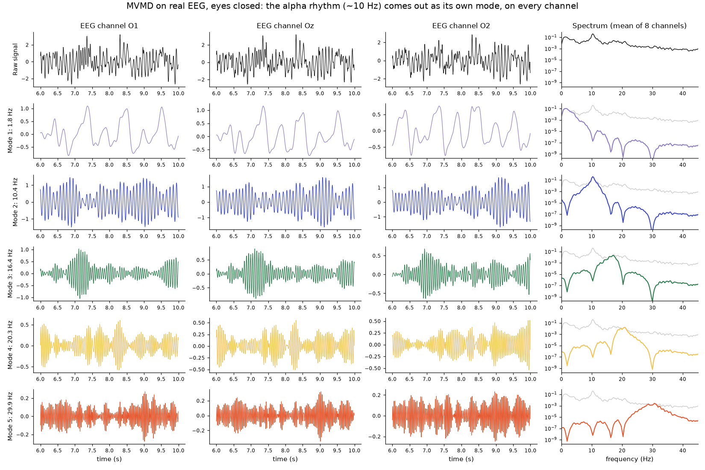

# mvmd-torch

**Multivariate Variational Mode Decomposition (MVMD) in PyTorch, on CPU or GPU.**

MVMD splits a multichannel signal into a few oscillatory **modes**: narrow frequency bands that are **shared by all channels**, each with its own amplitude on each channel. It is well suited to signals recorded by many sensors at once, such as EEG and MEG, where the same brain rhythm is seen by many sensors.

This implementation runs on the GPU with PyTorch, which makes the decomposition tractable on recordings with hundreds of channels. It was written for the analysis of resting-state MEG (306 sensors) in my Master's thesis.



*Real EEG with eyes closed (PhysioNet, 8 occipital channels): MVMD separates the alpha rhythm (mode 2, 10.4 Hz), present on every channel, from slow waves and from bursts of beta activity that are invisible in the raw signal. See [notebook 02](notebooks/02_real_eeg_alpha_rhythm.ipynb).*

## Install

```sh
pip install git+https://github.com/sbendimerad/mvmd-torch.git
```

or, from a clone of the repository, `pip install -e .` (add `[examples]` for the notebook, `[test]` for the tests).

## Quick start

```python
import torch
from mvmd_torch import mvmd

signal = torch.randn(64, 5000)          # (channels, samples)
u, u_hat, omega = mvmd(signal, alpha=2000, tau=0, K=5, DC=False, init=1, tol=1e-7, max_N=500)

u.shape                                  # (K, samples, channels): the modes
centre_frequencies_hz = omega.real.ravel() * 250   # times your sampling rate (Hz)
```

Two notebooks show how to use it:

| Notebook | What it shows |
|---|---|
| [01 · Getting started](notebooks/01_getting_started.ipynb) | a synthetic 6-channel signal with three rhythms (10, 20 and 40 Hz): the modes recover each rhythm with the right amplitude on each channel |
| [02 · Real EEG: the alpha rhythm](notebooks/02_real_eeg_alpha_rhythm.ipynb) | 8 EEG channels recorded with eyes closed: MVMD isolates the alpha rhythm and the beta bursts (needs `pip install mne`; the data is downloaded automatically) |

## Parameters

| Parameter | Meaning |
|---|---|
| `signal` | tensor of shape `(C, T)`: C channels, T samples |
| `alpha` | bandwidth constraint: the larger, the narrower each mode (2000 is a common value) |
| `tau` | time-step of the dual ascent (0 for noise-slack) |
| `K` | number of modes |
| `DC` | `True` to keep the first mode at 0 Hz |
| `init` | initial centre frequencies: 0 = all at 0, 1 = uniformly spread, 2 = random |
| `tol` | tolerance of the convergence criterion (1e-6 to 1e-7) |
| `max_N` | maximum number of iterations |

It returns the modes `u` `(K, T, C)`, their spectra `u_hat` `(T, K, C)` and their centre frequencies `omega` `(1, K)`, normalised by the sampling rate.

## Tests

```sh
pip install -e ".[test]"
pytest
```

The tests check the shapes, the recovered frequencies, that the modes of each channel add up to the signal of **the same** channel, and that every initialisation runs.

## Credits

This is a PyTorch port of MVMD, built on the reference MATLAB code of MVMD and on the vmdpy port of VMD:

- N. ur Rehman and H. Aftab, *Multivariate Variational Mode Decomposition*, IEEE Transactions on Signal Processing, 67(23), 2019.
- K. Dragomiretskiy and D. Zosso, *Variational Mode Decomposition*, IEEE Transactions on Signal Processing, 62(3), 2014.
- [vmdpy](https://github.com/vrcarva/vmdpy), the Python implementation of VMD by V. Carvalho.

The EEG of notebook 02 comes from the [EEG Motor Movement/Imagery Dataset](https://physionet.org/content/eegmmidb/1.0.0/) (G. Schalk et al., 2004), distributed by PhysioNet under the ODC-By 1.0 licence.

If you use this code, please cite the MVMD paper above, and this repository.

## Author

[Sabrine Bendimerad](https://sbendimerad.github.io). Developed for my Master's thesis, [*Improved multifractal analysis of brain oscillations in MEG time series*](https://github.com/sbendimerad/mfa-internship/blob/main/report/Bendimerad_2025_MSc_thesis_multifractal_MEG.pdf) (Université Paris-Saclay / CentraleSupélec, 2025).

Licence: [MIT](LICENSE).
